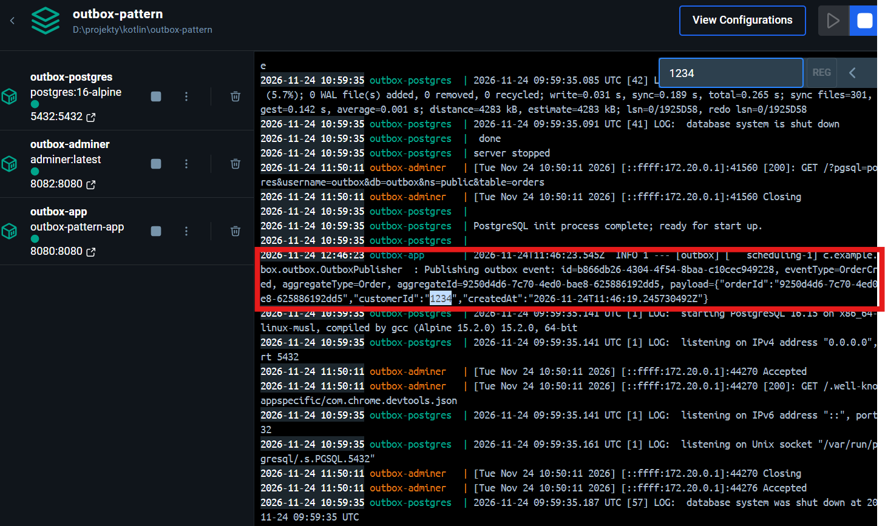

# Weryfikacja działania (testy manualne na Docker Compose)

Po uruchomieniu stosu (`docker compose up -d --build`) i wysłaniu żądania `POST /orders` dla `customerId: "1234"` działanie wzorca Transactional Outbox zostało potwierdzone w bazie danych oraz logach aplikacji:

1. **Zapis zamówienia w tabeli `orders` (Adminer):**
   

2. **Zapis zdarzenia w tabeli `outbox_events` w tej samej transakcji (Adminer):**
   

3. **Publikacja zdarzenia `OrderCreated` przez `OutboxPublisher` (logi kontenera `outbox-app`):**
   
